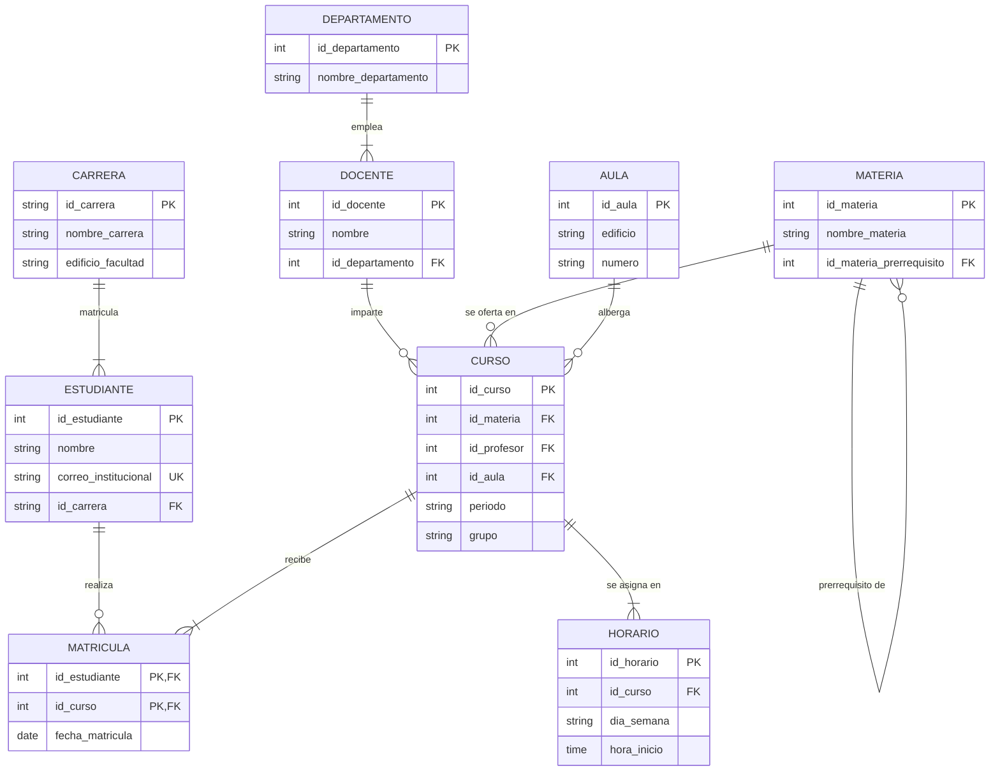

# Fundamentos del Modelo Relacional en Sistemas de Bases de Datos
**Documento de Investigación Teórico-Práctica**

* **Materia:** Fundamentos de Bases de Datos  
* **Carrera:** Ingeniería de Software / Sistemas Computacionales  
* **Caso de estudio transversal:** Sistema de Control Escolar y Gestión Académica  
* **Nivel:** Universitario (formativo / principiantes)  
* **Fecha:** Octubre de 2026  

---

## Introducción al Caso de Estudio
Para comprender la teoría relacional mediante situaciones reales de la ingeniería de software, este trabajo utiliza como hilo conductor el **Sistema de Control Escolar** de una universidad. Dicho sistema coordina el flujo académico institucional a través de las siguientes entidades principales:
* **Estudiante:** Alumnos matriculados en la institución.
* **Docente / Profesor:** Personal académico que imparte la cátedra.
* **Departamento:** Unidad académica y administrativa (ej. Ciencias Computacionales).
* **Carrera:** Programa educativo cursado por los estudiantes.
* **Asignatura / Materia:** Contenido curricular oficial del plan de estudios.
* **Aula:** Instalación física donde se imparten las clases.
* **Curso:** Apertura formal de una materia en un periodo lectivo, grupo y aula específicos.
* **Horario:** Asignación de días y bloques temporales para cada curso.
* **Matrícula:** Registro formal de inscripción de un estudiante a un curso.
* **Calificación:** Evaluaciones y registros de aprovechamiento escolar.

---

## 1. Modelo Relacional: Entidad, Atributo, Tupla y Relación

### 1. Fundamento teórico
Propuesto formalmente por Edgar F. Codd en 1970 en los laboratorios de IBM, el modelo relacional transformó la gestión de datos al sustentarse en la teoría matemática de conjuntos y la lógica de predicados. Modela el mundo real mediante colecciones de tablas independientes conectadas por valores compartidos:
* **Entidad:** Cualquier objeto o concepto identificable del mundo real (tangible como un docente, o conceptual como una inscripción) sobre el cual se recolecta información.
* **Atributo:** Característica, dimensión o propiedad elemental que describe a la entidad. Cada atributo posee un **dominio**, definido como el conjunto acotado de valores válidos y tipos de datos aceptables (físicamente representa una columna).
* **Tupla:** Lista ordenada de valores que corresponden a cada uno de los atributos de una entidad para una ocurrencia concreta. Representa una instancia particular de datos (físicamente representa una fila o registro).
* **Relación:** En el plano matemático, es un subconjunto del producto cartesiano de los dominios de los atributos. En el plano práctico de ingeniería, es la estructura tabular bidimensional (la tabla) formada por el conjunto total de tuplas que comparten idéntico esquema. Su número de columnas determina su *grado*, y su volumen de filas su *cardinalidad*.

### 2. Aplicación en el caso escolar
* **Entidad:** `Estudiante`.
* **Atributos:** `id_estudiante` (entero positivo), `nombre` (texto alfabético), `correo_institucional` (cadena de dominio escolar) y `fecha_ingreso` (formato fecha).
* **Tupla:** `(202601, 'Valeria', 'Méndez', 'valeria.mendez@universidad.edu', '2026-08-15')`.
* **Relación:** La tabla `Estudiantes`, la cual reúne a todos los estudiantes de la institución educativa.

### 3. Implementación en SQL
```sql
-- Creación de la relación Estudiantes con sus atributos y tipos de datos
CREATE TABLE Estudiantes (
    id_estudiante INT,
    nombre VARCHAR(50),
    apellido VARCHAR(50),
    correo_institucional VARCHAR(100),
    fecha_ingreso DATE
);

-- Inserción de una tupla completa dentro de la relación
INSERT INTO Estudiantes (id_estudiante, nombre, apellido, correo_institucional, fecha_ingreso)
VALUES (202601, 'Valeria', 'Méndez', 'valeria.mendez@universidad.edu', '2026-08-15');
```

---

## 2. Llaves: Primaria (PK), Foránea (FK), Candidata y Compuesta

### 1. Fundamento teórico
Las llaves (*keys*) constituyen el mecanismo estructural que garantiza la unicidad de las tuplas e impide la existencia de registros duplicados o ambiguos:
* **Superllave:** Cualquier combinación de uno o más atributos que permite identificar de forma unívoca a una fila dentro de una relación.
* **Llave Candidata:** Superllave mínima. Es decir, un conjunto irreductible de atributos capaz de distinguir cada tupla sin que sobre ningún campo. Una tabla puede tener varias llaves candidatas.
* **Llave Primaria (Primary Key - PK):** Es la llave candidata elegida formalmente por el arquitecto de datos como identificador oficial de la relación. No admite valores nulos (`NOT NULL`) ni duplicados bajo ninguna circunstancia.
* **Llave Foránea (Foreign Key - FK):** Atributo en una relación hija que hace referencia directa a la llave primaria de una relación padre, estableciendo la conexión semántica entre ambas.
* **Llave Compuesta:** Llave cuya definición exige la unión simultánea de dos o más atributos debido a que ninguno por separado logra garantizar la unicidad de cada fila.

### 2. Aplicación en el caso escolar
1. En la relación `Estudiantes`, tanto el número de matrícula (`id_estudiante`) como la clave de documento de identidad (`curp_dni`) son **llaves candidatas**. Se adopta `id_estudiante` como la **Llave Primaria (PK)**.
2. En la relación `Matriculas`, las columnas `id_estudiante` e `id_curso` son **Llaves Foráneas (FK)**.
3. Para impedir que un alumno se matricule dos veces al mismo curso en un ciclo escolar determinado, se forma una **Llave Primaria Compuesta** con: `(id_estudiante, id_curso)`.

### 3. Implementación en SQL
```sql
CREATE TABLE Matriculas (
    id_estudiante INT,
    id_curso INT,
    fecha_matricula DATE,
    estado VARCHAR(20),
    -- Llave primaria compuesta:
    PRIMARY KEY (id_estudiante, id_curso),
    -- Llaves foráneas con validación referencial:
    CONSTRAINT fk_matricula_estudiante 
        FOREIGN KEY (id_estudiante) REFERENCES Estudiantes(id_estudiante),
    CONSTRAINT fk_matricula_curso 
        FOREIGN KEY (id_curso) REFERENCES Cursos(id_curso)
);
```

---

## 3. Tipos de Relaciones y Cardinalidad: 1:1, 1:N y N:M

### 1. Fundamento teórico
La cardinalidad máxima describe el número máximo de ocurrencias de una entidad asociables con ocurrencias de otra:
* **Uno a Uno (1:1):** Cada fila de la tabla A se asocia con a lo sumo una fila de la tabla B, y viceversa. Se materializa alojando la llave foránea en una de las dos tablas con restricción de unicidad (`UNIQUE`).
* **Uno a Muchos (1:N):** Una fila de la tabla A se asocia con múltiples filas de la tabla B, pero cada fila de B procede de una sola fila de A. Se implementa situando la llave foránea en la tabla del extremo "Muchos" (N).
* **Muchos a Muchos (N:M):** Múltiples filas de A se asocian con múltiples de B. Las bases de datos relacionales prohíben la implementación directa de relaciones N:M por violar la atomicidad; se resuelven dividiéndolas en dos relaciones 1:N coordinadas por una **tabla intermedia o asociativa**.

### 2. Tabla Comparativa de Relaciones

| Tipo de Relación | Descripción Conceptual | Ejemplo en el Sistema Escolar | Implementación en SQL |
| :--- | :--- | :--- | :--- |
| **Uno a Uno (1:1)** | Una instancia de A se asocia únicamente con una instancia de B, y viceversa. | Cada `Docente` tiene asignado un solo `CubiculoDocente`, y cada cubículo pertenece a un solo docente. | La llave foránea (`id_docente`) se ubica en la tabla secundaria con la restricción `UNIQUE`. |
| **Uno a Muchos (1:N)** | Una instancia de A se conecta con varias de B, pero una de B solo con una de A. | Un `Departamento` agrupa a múltiples `Docentes`, pero cada docente labora en un solo departamento. | La llave foránea (`id_departamento`) se define directamente en la tabla dependiente `Docentes`. |
| **Muchos a Muchos (N:M)** | Múltiples instancias de A se relacionan con múltiples instancias de B. | Los `Estudiantes` se inscriben a muchos `Cursos`, y cada `Curso` alberga a muchos `Estudiantes`. | Se crea una tabla asociativa intermedia (`Matriculas`) con llaves foráneas a ambas entidades maestras. |

### 3. Implementación en SQL
```sql
-- 1. Relación 1:1 (Uso de UNIQUE sobre la llave foránea)
CREATE TABLE CubiculosDocentes (
    id_cubiculo INT PRIMARY KEY,
    id_docente INT NOT NULL UNIQUE,
    edificio VARCHAR(20),
    numero_puerta VARCHAR(10),
    FOREIGN KEY (id_docente) REFERENCES Docentes(id_docente)
);

-- 2. Relación 1:N (Llave foránea en la tabla del lado "Muchos")
CREATE TABLE Docentes (
    id_docente INT PRIMARY KEY,
    nombre VARCHAR(50) NOT NULL,
    apellido VARCHAR(50) NOT NULL,
    id_departamento INT NOT NULL, -- Lado Muchos (N)
    FOREIGN KEY (id_departamento) REFERENCES Departamentos(id_departamento)
);

-- 3. Relación N:M (Tabla asociativa intermedia con dos FKs)
CREATE TABLE Matriculas (
    id_estudiante INT NOT NULL,
    id_curso INT NOT NULL,
    fecha_registro DATE DEFAULT CURRENT_DATE,
    PRIMARY KEY (id_estudiante, id_curso),
    FOREIGN KEY (id_estudiante) REFERENCES Estudiantes(id_estudiante),
    FOREIGN KEY (id_curso) REFERENCES Cursos(id_curso)
);
```

---

## 4. Participación: Obligatoria vs Opcional, Cardinalidad Mínima y Máxima

### 1. Fundamento teórico
La asociación entre entidades no solo se define por su cota superior, sino por sus restricciones de existencia:
* **Notación Estructural `(min, max)`:** Par de valores enteros donde `min` representa la cantidad mínima de vinculaciones que debe tener una instancia para existir, y `max` representa el límite superior.
* **Participación Obligatoria (Total):** Se presenta cuando `min = 1`. Ninguna tupla de la entidad puede existir en la base de datos sin estar enlazada forzosamente a otra entidad.
* **Participación Opcional (Parcial):** Se presenta cuando `min = 0`. La tupla de la entidad puede existir libremente en el sistema aun cuando no participe en ningún enlace con la otra entidad.

### 2. Aplicación en el caso escolar
* **Relación `Estudiantes` con `Matriculas` `(0, N)` - Opcional:** Un alumno de nuevo ingreso puede ser registrado formalmente en la universidad antes del inicio del periodo escolar; en ese momento, tiene 0 cursos matriculados.
* **Relación `Cursos` con `Asignaturas` `(1, 1)` - Obligatoria:** Un curso académico no puede darse de alta ni existir administrativamente en el catálogo sin tener asignada una asignatura del plan de estudios.

### 3. Implementación en SQL
En la sintaxis SQL de definición de datos (DDL), la participación obligatoria de una relación se exige aplicando `NOT NULL` sobre la llave foránea; si la relación es opcional, la columna foránea permite valores nulos (`NULL`).

```sql
CREATE TABLE Cursos (
    id_curso INT PRIMARY KEY,
    -- Participación obligatoria (min = 1): Todo curso debe pertenecer a una materia
    id_materia INT NOT NULL,
    -- Participación obligatoria (min = 1): Todo curso debe tener profesor asignado
    id_profesor INT NOT NULL,
    -- Participación opcional (min = 0): El aula puede quedar sin asignar provisionalmente
    id_aula INT NULL,
    periodo VARCHAR(15) NOT NULL,
    grupo VARCHAR(5) NOT NULL,
    FOREIGN KEY (id_materia) REFERENCES Materias(id_materia),
    FOREIGN KEY (id_profesor) REFERENCES Docentes(id_docente),
    FOREIGN KEY (id_aula) REFERENCES Aulas(id_aula)
);
```

---

## 5. Relaciones Recursivas (Reflexivas)

### 1. Fundamento teórico
Una relación recursiva (o reflexiva) es aquella en la que una misma entidad participa más de una vez con roles diferentes. Este patrón se utiliza para modelar jerarquías organizacionales, estructuras de subordinación, árboles genealógicos y dependencias de precedencia. Se implementa incluyendo una columna en la tabla que actúa como llave foránea y hace referencia a la llave primaria de su propia tabla.

### 2. Aplicación en el caso escolar
* **Malla Curricular (Prerrequisitos):** En la entidad `Materias`, para cursar la asignatura "Bases de Datos II" se exige haber aprobado con anterioridad "Bases de Datos I". Ambas corresponden a filas contenidas en la misma tabla `Materias`.
* **Coordinación Docente:** Un docente puede fungir como coordinador o jefe inmediato de otros docentes dentro del mismo cuerpo académico.

### 3. Implementación en SQL y Consulta Demostrativa
```sql
CREATE TABLE Materias (
    id_materia INT PRIMARY KEY,
    clave_materia VARCHAR(10) NOT NULL UNIQUE,
    nombre VARCHAR(100) NOT NULL,
    creditos INT NOT NULL,
    -- Llave foránea recursiva hacia la misma tabla:
    id_materia_prerrequisito INT NULL,
    CONSTRAINT fk_materia_prerrequisito 
        FOREIGN KEY (id_materia_prerrequisito) REFERENCES Materias(id_materia)
);

-- Consulta de verificación usando Auto-Combinación (Self-Join):
SELECT 
    m.nombre AS Asignatura_Avanzada,
    COALESCE(p.nombre, 'Sin prerrequisito (Curso Inicial)') AS Requisito_Obligatorio
FROM Materias m
LEFT JOIN Materias p ON m.id_materia_prerrequisito = p.id_materia;
```

---

## 6. Integridad Referencial: ON DELETE CASCADE, SET NULL y RESTRICT

### 1. Fundamento teórico
La **Integridad Referencial** es una regla semántica que garantiza que los enlaces entre relaciones se mantengan siempre coherentes. Exige que todo valor presente en una llave foránea apunte a una llave primaria real y existente en la tabla padre, evitando la aparición de "registros huérfanos".

Al momento de ejecutar una operación de borrado (`DELETE`) sobre un registro de la tabla padre, el motor de la base de datos ejecuta la directiva de integridad referencial configurada:
* **CASCADE (En Cascada):** Elimina en cadena y de forma automática todas las tuplas de la tabla hija que dependen del registro padre borrado.
* **SET NULL (Establecer Nulo):** Preserva las tuplas de la tabla hija, pero asigna el valor `NULL` a la columna foránea que las vinculaba con el padre (exige que la columna acepte nulos).
* **RESTRICT (o NO ACTION):** Intercepta e impide la eliminación del registro padre mientras exista al menos una tupla hija asociada a él, cancelando la operación y arrojando una excepción.

### 2. Aplicación en el caso escolar
* **Uso de CASCADE:** Si la coordinación elimina un `Curso` ofertado por falta de matrícula, sus franjas horarias en la tabla `Horarios` deben borrarse automáticamente en cascada.
* **Uso de SET NULL:** Si un `Docente` deja temporalmente su puesto, en la tabla `Cursos` la columna `id_profesor` se fija en `NULL` mientras se contrata a un profesor suplente, sin destruir la oferta del curso.
* **Uso de RESTRICT:** La administración escolar no puede eliminar la ficha de un `Estudiante` si este tiene notas asentadas en la tabla `Calificaciones` o adeudos de material en biblioteca.

### 3. Implementación en SQL
```sql
-- 1. Aplicación de CASCADE para no dejar bloques de horario huérfanos
CREATE TABLE Horarios (
    id_horario INT PRIMARY KEY,
    id_curso INT NOT NULL,
    dia_semana VARCHAR(10) NOT NULL,
    hora_inicio TIME NOT NULL,
    hora_fin TIME NOT NULL,
    CONSTRAINT fk_horario_curso 
        FOREIGN KEY (id_curso) REFERENCES Cursos(id_curso)
        ON DELETE CASCADE
);

-- 2. Aplicación de RESTRICT para proteger el historial académico
CREATE TABLE Calificaciones (
    id_calificacion INT PRIMARY KEY,
    id_estudiante INT NOT NULL,
    id_curso INT NOT NULL,
    nota DECIMAL(4,2) NOT NULL,
    CONSTRAINT fk_calif_estudiante 
        FOREIGN KEY (id_estudiante) REFERENCES Estudiantes(id_estudiante)
        ON DELETE RESTRICT,
    CONSTRAINT fk_calif_curso 
        FOREIGN KEY (id_curso) REFERENCES Cursos(id_curso)
        ON DELETE RESTRICT
);
```

---

## 7. Restricciones: NOT NULL, UNIQUE, CHECK, DEFAULT y AUTO_INCREMENT

### 1. Fundamento teórico
Las restricciones (*integrity constraints*) son directivas declarativas integradas directamente en el motor de base de datos. Garantizan la fidelidad de los datos antes de persistir cualquier transacción:
* **NOT NULL:** Impide el ingreso de valores ausentes o nulos en una columna; el campo es mandatorio.
* **UNIQUE:** Garantiza que todos los datos contenidos en la columna sean distintos en cada fila; no admite duplicados.
* **CHECK:** Evalúa una condición lógica booleana sobre el dato que se pretende ingresar; si la prueba resulta falsa, la transacción se aborta.
* **DEFAULT:** Asigna un valor predeterminado si la instrucción de inserción omite especificar un dato explícito.
* **AUTO_INCREMENT (o SERIAL / IDENTITY):** Delega al motor la generación automática de un valor numérico secuencial entero único para cada nuevo registro.

### 2. Aplicación en el caso escolar
* `id_calificacion`: Identificador autogenerado por el sistema (`AUTO_INCREMENT`).
* `nombre`: Nombre del alumno obligatorio (`NOT NULL`).
* `correo_institucional`: No se puede duplicar entre miembros del instituto (`UNIQUE`).
* `nota`: Debe encontrarse estrictamente en la escala oficial de 0.00 a 10.00 (`CHECK`).
* `estado_alumno`: Si no se indica estatus en la matrícula, se asume 'Inscrito' (`DEFAULT`).

### 3. Implementación en SQL
```sql
CREATE TABLE CalificacionesDetalladas (
    id_calificacion INT AUTO_INCREMENT PRIMARY KEY, -- AUTO_INCREMENT
    id_estudiante INT NOT NULL,                     -- NOT NULL
    id_curso INT NOT NULL,                          -- NOT NULL
    folio_evaluacion VARCHAR(25) NOT NULL UNIQUE,   -- UNIQUE
    nota DECIMAL(4,2) NOT NULL,
    tipo_examen VARCHAR(20) DEFAULT 'Ordinario',    -- DEFAULT
    -- CHECK: Restringe el rango admisible de notas escolares
    CONSTRAINT chk_rango_nota CHECK (nota >= 0.00 AND nota <= 10.00),
    -- CHECK: Restringe los tipos de evaluación académica permitidos
    CONSTRAINT chk_tipo_valido CHECK (tipo_examen IN ('Ordinario', 'Extraordinario', 'Titulo'))
);
```

---

## 8. Normalización: 1FN, 2FN y 3FN, con Tabla Antes y Después

### 1. Fundamento teórico
La normalización es un procedimiento metódico de descomposición formal diseñado para depurar el esquema de bases de datos, erradicando la redundancia y suprimiendo anomalías de inserción, actualización y borrado:
* **Primera Forma Normal (1FN):**
  * Todos los atributos deben almacenar valores **atómicos** (elementales e indivisibles para el sistema; prohíbe listas o conjuntos separados por delimitadores en una misma celda).
  * La relación debe contar con una Llave Primaria definida.
* **Segunda Forma Normal (2FN):**
  * La relación debe encontrarse en 1FN.
  * Ningún atributo no clave debe depender parcialmente de una Llave Primaria compuesta. Todo atributo no clave debe exhibir **dependencia funcional completa** de la totalidad de la llave primaria.
* **Tercera Forma Normal (3FN):**
  * La relación debe encontrarse en 2FN.
  * Ningún atributo no clave debe depender de otro atributo no clave. Se eliminan por completo las **dependencias funcionales transitivas** ($X \rightarrow Y$ y $Y \rightarrow Z$).

---

### 2. Ejemplo en el Sistema Escolar: Antes y Después

#### Tabla ANTES de normalizar (Estado en 0FN - No Normalizado)
La administración registra las inscripciones en una única planilla denominada `ReporteGeneralInscripciones`:

| id_estudiante | nombre_estudiante | materias_cursadas (Viola 1FN) | id_carrera | nombre_carrera (Viola 3FN) | edificio_facultad (Viola 3FN) |
| :--- | :--- | :--- | :--- | :--- | :--- |
| 202601 | Valeria Méndez | Cálculo, Programación | ISC | Ing. Sistemas Computacionales | Edificio Alpha |
| 202602 | Santiago Lara | Cálculo | ISC | Ing. Sistemas Computacionales | Edificio Alpha |

**Diagnóstico de anomalías:**
1. **Violación de 1FN:** La celda `materias_cursadas` aloja múltiples valores. No es posible indexar materias ni realizar cálculos agregados confiables.
2. **Violación de 2FN:** Al desglosar las materias en filas individuales bajo la llave compuesta `(id_estudiante, materia)`, el `nombre_estudiante` depende exclusivamente de `id_estudiante`, incurriendo en dependencia parcial.
3. **Violación de 3FN:** `edificio_facultad` depende de `id_carrera`, no directamente de `id_estudiante`. Si la facultad de Sistemas cambia de edificio, se tendrían que actualizar miles de filas individuales de estudiantes.

---

#### Tablas DESPUÉS de normalizar (Esquema Depurado en 3FN)
La información se descompone en cuatro entidades atómicas e interrelacionadas:

```
[Carreras]
  - id_carrera (PK)
  - nombre_carrera
  - edificio_facultad

[Estudiantes]
  - id_estudiante (PK)
  - nombre_estudiante
  - id_carrera (FK -> Carreras.id_carrera)

[Materias]
  - id_materia (PK)
  - nombre_materia

[Matriculas]
  - id_estudiante (FK -> Estudiantes.id_estudiante)
  - id_materia (FK -> Materias.id_materia)
  (Llave Primaria Compuesta: id_estudiante, id_materia)
```

### 3. Implementación en SQL
```sql
-- 1. Tabla Carreras (Elimina la dependencia transitiva - 3FN)
CREATE TABLE Carreras (
    id_carrera VARCHAR(10) PRIMARY KEY,
    nombre_carrera VARCHAR(100) NOT NULL,
    edificio_facultad VARCHAR(50) NOT NULL
);

-- 2. Tabla Estudiantes (Vinculada por FK)
CREATE TABLE Estudiantes (
    id_estudiante INT PRIMARY KEY,
    nombre_estudiante VARCHAR(100) NOT NULL,
    id_carrera VARCHAR(10) NOT NULL,
    FOREIGN KEY (id_carrera) REFERENCES Carreras(id_carrera)
);

-- 3. Tabla Materias (Valores atómicos - 1FN)
CREATE TABLE Materias (
    id_materia INT PRIMARY KEY,
    nombre_materia VARCHAR(100) NOT NULL
);

-- 4. Tabla Matriculas (Resuelve la relación N:M y dependencias parciales - 2FN)
CREATE TABLE Matriculas (
    id_estudiante INT NOT NULL,
    id_materia INT NOT NULL,
    fecha_inscripcion DATE DEFAULT CURRENT_DATE,
    PRIMARY KEY (id_estudiante, id_materia),
    FOREIGN KEY (id_estudiante) REFERENCES Estudiantes(id_estudiante),
    FOREIGN KEY (id_materia) REFERENCES Materias(id_materia)
);
```

---

## 9. Notaciones del DER: Diferencias entre Chen y Pata de Gallo (Crow's Foot)

### 1. Fundamento teórico
El Diagrama Entidad-Relación (DER) es la técnica gráfica fundamental para el modelado de datos conceptual y lógico:
* **Notación de Peter Chen (1976):** Desarrollada en el artículo seminal del modelo. Tiene un enfoque conceptual y estrictamente pedagógico. Las entidades se modelan como rectángulos, los atributos como elipses conectadas por líneas, y las relaciones como rombos centrales con verbos de enlace. La cardinalidad se detalla textualmente sobre los conectores.
* **Notación Pata de Gallo (Crow's Foot / Barker):** Popularizada en la ingeniería de software y herramientas CASE. Posee un enfoque compacto y orientado a la construcción física de bases de datos. Los atributos se colocan directamente dentro del cuerpo de la entidad. Las cardinalidades y reglas de participación se representan en los extremos de las líneas mediante símbolos gráficos directos (círculos, barras y tridentes).

### 2. Tabla Comparativa de Simbología

| Componente del Modelo | Notación de Peter Chen | Notación Pata de Gallo (Crow's Foot) |
| :--- | :--- | :--- |
| **Entidad** | Rectángulo simple con el nombre de la entidad. | Caja rectangular dividida en encabezado y lista de atributos. |
| **Atributo** | Óvalos o elipses que cuelgan del rectángulo de la entidad. | Filas de texto escritas dentro de la caja de la entidad. |
| **Llave Primaria (PK)** | Óvalo con el nombre del atributo subrayado. | Texto con prefijo `PK` o colocado en la división superior. |
| **Relación** | Rombo etiquetado con un verbo en medio de las entidades. | Línea directa de conexión continua o discontinua. |
| **Cero (Opcional)** | Texto `0` o etiqueta de rango `(0, n)` sobre la línea. | Círculo pequeño (`O`) situado en el extremo de la línea. |
| **Uno (Obligatorio)** | Texto `1` o etiqueta de rango `(1, 1)` sobre la línea. | Una barra perpendicular (`|`) en el extremo. |
| **Muchos** | Letra `N` o `M` sobre el conector. | Tridente abierto o "pata de gallo" (`>-`). |
| **Uno a Muchos Obligatorio**| Etiqueta `(1, N)`. | Barra perpendicular seguida de tridente (`|<`). |
| **Cero a Muchos Opcional** | Etiqueta `(0, N)`. | Círculo seguido de tridente (`O<`). |

### 3. Ejemplo Comparativo y Diagrama Integral en Mermaid
Relación: *"Un Docente imparte muchos Cursos, y un Curso es impartido por un único Docente"*.
* **En Chen:** `[Docente]` ─── `<Imparte>` ─── `(N) [Curso]`, con elipses `(nombre)` y `(correo)` unidas a `[Docente]`.
* **En Pata de Gallo:** El recuadro `Docente` se conecta con una línea directa al recuadro `Curso`. Del lado de `Docente` se dibujan dos barras (`||`, exactamente un docente obligatorio) y del lado de `Curso` un círculo y un tridente (`O<`, cero a muchos cursos).

A continuación se muestra el esquema del Sistema Escolar diagramado en notación Pata de Gallo:



---

## Fuentes Consultadas

* **Chen, P. P.** (1976). *The Entity-Relationship Model—Toward a Unified View of Data*. ACM Transactions on Database Systems (TODS), 1(1), 9–36. https://doi.org/10.1145/320434.320440
* **Codd, E. F.** (1970). *A relational model of data for large shared data banks*. Communications of the ACM, 13(6), 377–387. https://doi.org/10.1145/362384.362685
* **Coronel, C., & Morris, S.** (2019). *Database Systems: Design, Implementation, & Management* (13.ª ed.). Cengage Learning.
* **Date, C. J.** (2004). *Introducción a los sistemas de bases de datos* (8.ª ed.). Pearson Educación.
* **Elmasri, R., & Navathe, S. B.** (2016). *Fundamentals of Database Systems* (7.ª ed.). Pearson Education.
* **Silberschatz, A., Korth, H. F., & Sudarshan, S.** (2014). *Fundamentos de bases de datos* (6.ª ed.). McGraw-Hill Education.
